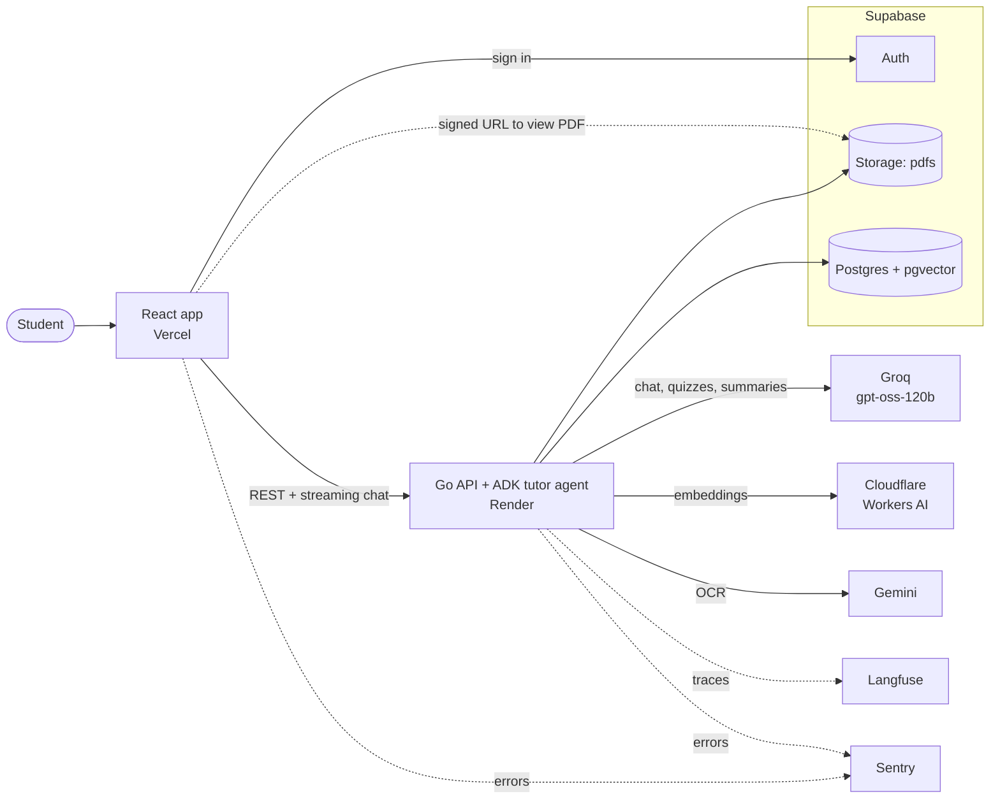

# PagePilot

Upload a PDF and ask it questions. Every answer cites its page, and you can turn any document into quizzes, flashcards and summaries.

**Stack:** Go + Google ADK, React + Vite, Supabase (Postgres + pgvector, Auth, Storage), Groq `gpt-oss-120b` for chat, Cloudflare Workers AI (`qwen3-embedding-0.6b`) for embeddings, Gemini for OCR of scanned pages. Langfuse (traces), Sentry (errors) and GitHub Actions (tests and evals) for observability.

**Deployed on:** Vercel (frontend), Render (API) and Supabase.

## Architecture



A more detailed diagram is in [docs/architecture.excalidraw](docs/architecture.excalidraw) (open in [Excalidraw](https://excalidraw.com)).

## Requirements

- Go 1.27+, Bun 1.4+, Docker Desktop
- A [Groq API key](https://console.groq.com/keys), a Cloudflare API token made with the **Workers AI** template (Cloudflare dashboard → My Profile → API Tokens), and a [Gemini API key](https://aistudio.google.com/apikey) for OCR
- Optional: Langfuse and Sentry projects (everything runs without them)

## Setup

```bash
bun install --cwd frontend
```

```bash
cp .env.example .env
```

Add your Groq key, Cloudflare token (`EMBEDDING_API_KEY`) and account id (in `EMBEDDING_BASE_URL`), and Gemini key to `.env`, and set the `OCR_*` rate limits from your AI Studio rate-limit page. Optionally add `GEMINI_FALLBACK_API_KEY`, a key from a second Google project that OCR switches to when the first runs out of quota.

```bash
bunx supabase start
```

```bash
bunx supabase status
```

Copy `PUBLISHABLE_KEY` into `SUPABASE_PUBLISHABLE_KEY` and `VITE_SUPABASE_PUBLISHABLE_KEY`, and `SECRET_KEY` into `SUPABASE_SECRET_KEY`.

## Run

```bash
cd backend && go run ./cmd/server
```

```bash
bun run --cwd frontend dev
```

Open http://localhost:5173 and create an account.

## Test

```bash
cd backend && go test ./...
```

```bash
bun run --cwd frontend lint
```

```bash
bun run --cwd frontend test
```

```bash
bun run --cwd frontend build
```

The Go tests need the local Supabase stack running, but no API keys.

## Evaluate the AI

The eval runs the real retrieval, agent, quiz and flashcard code against four study documents in `backend/evaluation`, on the local database, and compares the results with the saved baseline. It runs on its own keys (`EVAL_GROQ_API_KEY`, `EVAL_CLOUDFLARE_API_KEY`, `EVAL_CLOUDFLARE_ACCOUNT_ID`), so it never uses production's daily limits, and stops starting new cases at 120k tokens (`-max-tokens`).

```bash
cd backend && go run ./cmd/eval -suite all -judge
```

Exit code 0 means every suite passed, 1 means one fell below a threshold or regressed, and 2 means rate limits or outages made the run inconclusive. After a deliberate change, add `-update-baseline` to save the run as the new baseline. See `backend/evaluation/README.md` for the datasets.

## CI

`.github/workflows/ci.yml` runs on every pull request and push to `main`, with no secrets: gofmt, `go vet` and `go test` against a local Supabase stack for the backend, then lint, tests and build for the frontend.

`.github/workflows/eval.yml` runs the full judged eval every Monday at 06:00 UTC and on demand (Actions → Evals → Run workflow). Add these repository secrets: `EVAL_GROQ_API_KEY`, `EVAL_CLOUDFLARE_API_KEY` and `EVAL_CLOUDFLARE_ACCOUNT_ID` (without them the run is skipped), and optionally `LANGFUSE_PUBLIC_KEY`, `LANGFUSE_SECRET_KEY` and `TAVILY_API_KEY`. The summary appears on the run page and the JSON report is kept as an artifact for 90 days. A regression fails the run; an inconclusive run is only a warning. A full run uses about half of Groq's free daily tokens for the agent model, so run it at most once a day.

## Changing the embedding model

Vectors from different models can't be compared, so changing the model means indexing every document again. To use the Gemini standby, set `EMBEDDING_PROVIDER=gemini`, `EMBEDDING_MODEL=gemini-embedding-2`, an empty `EMBEDDING_QUERY_PREFIX` and the `EMBEDDING_RPM/TPM/RPD` limits, keep `EMBEDDING_DIM=1024`, and have users re-upload. A model with a different vector size also needs a migration that changes `document_chunks.embedding`; the API refuses to start when the two don't match.

The move to Cloudflare (`supabase/migrations/20261108000000_embedding_1024.sql`) deletes every existing document, with its chunks, quizzes, flashcards and summaries, because they were indexed with 1536-dimension Gemini vectors. To deploy it:

1. Set the new `EMBEDDING_*` variables on Render.
2. Apply the migration: `bunx supabase db push`.
3. Deploy the API.
4. Empty the `pdfs` bucket in the Supabase dashboard (Storage → pdfs → Empty bucket). SQL can't delete stored files, so the old uploads stay there until you do.

## Notes

- Every setting is listed in `.env.example`.
- Database changes are migrations in `supabase/migrations`. Apply new ones with `bunx supabase migration up`.
- Document text is sent to Cloudflare Workers AI for embeddings, and scanned pages to Google's Gemini API for OCR. On the free tier Google may use that content, so don't upload sensitive scanned files.
- Prompts and answers are not sent to Langfuse unless `OTEL_INSTRUMENTATION_GENAI_CAPTURE_MESSAGE_CONTENT=SPAN_ONLY`; users appear there only as a hashed id.
