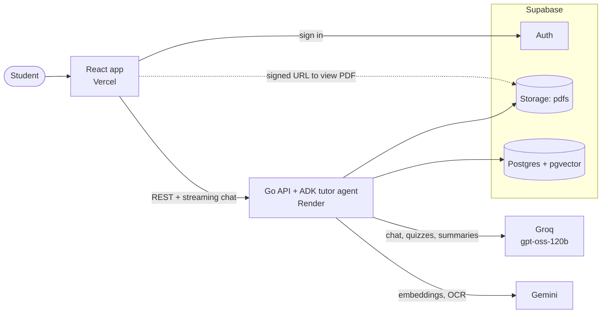

# PagePilot

Upload a PDF and ask it questions. Every answer cites its page, and you can turn any document into quizzes, flashcards and summaries.

**Stack:** Go + Google ADK, React + Vite, Supabase (Postgres + pgvector, Auth, Storage), Groq `gpt-oss-120b` for chat, Gemini for embeddings and OCR of scanned pages.

**Deployed on:** Vercel (frontend), Render (API) and Supabase.

## Architecture



A more detailed diagram is in [docs/architecture.excalidraw](docs/architecture.excalidraw) (open in [Excalidraw](https://excalidraw.com)).

## Requirements

- Go 1.27+, Bun 1.4+, Docker Desktop
- A [Groq API key](https://console.groq.com/keys) and a [Gemini API key](https://aistudio.google.com/apikey)

## Setup

```bash
bun install --cwd frontend
```

```bash
cp .env.example .env
```

Add your Groq and Gemini keys to `.env`, and set the `EMBEDDING_*` and `OCR_*` rate limits from your AI Studio rate-limit page.

```bash
bunx supabase start
```

```bash
bunx supabase status
```

Copy `PUBLISHABLE_KEY` into `SUPABASE_PUBLISHABLE_KEY` and `VITE_SUPABASE_PUBLISHABLE_KEY`, and `SECRET_KEY` into `SUPABASE_SECRET_KEY`.

## Run

```bash
cd backend && go run ./cmd/server
```

```bash
bun run --cwd frontend dev
```

Open http://localhost:5173 and create an account.

## Test

```bash
cd backend && go test ./...
```

```bash
bun run --cwd frontend build
```

The Go tests need the local Supabase stack running, but no API keys.

## Notes

- Every setting is listed in `.env.example`.
- Database changes are migrations in `supabase/migrations`. Apply new ones with `bunx supabase migration up`.
- PDFs are sent to Google's Gemini API. On the free tier Google may use that content, so don't upload sensitive files.
