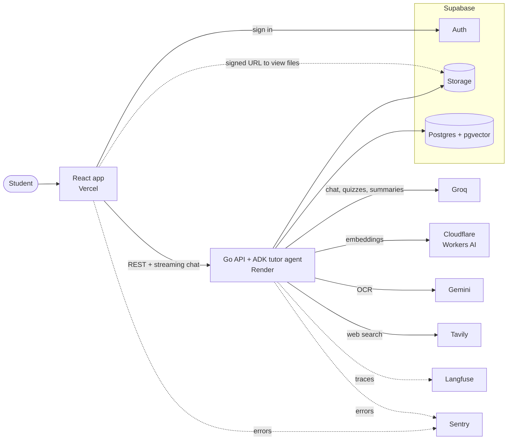

# PagePilot

An AI study assistant for your documents. Upload a file, ask questions, and get answers that cite where they came from. Turn any document into quizzes, flashcards and summaries.

**Live:** https://pagepilot.sumit0804.space

## Features

- **Many formats:** PDF, Word (.docx), PowerPoint (.pptx), Markdown, text, CSV and HTML. Scanned PDF pages are read with OCR.
- **Cited answers:** every answer links to the part of the document it came from.
- **AI agent with tools:** it decides when to search your documents, search the web, or make a quiz or flashcards.
- **Study tools:** quizzes, flashcards and cached summaries.
- **Guest mode:** try it without an account.
- **Observability:** every AI request is a trace in Langfuse (steps, tools, tokens, timing). Errors go to Sentry with the trace ID, so an error leads straight to its trace. Thumbs up/down ratings are saved on the trace.
- **Evals:** 72 test cases check retrieval, tool choice, answer quality, quizzes and flashcards against a saved baseline, every week in GitHub Actions.

## Tech stack

| Part | Tools |
| --- | --- |
| Backend | Go, Google ADK (agent) |
| Frontend | React, Vite |
| Database, auth, files | Supabase (Postgres + pgvector, Auth, Storage) |
| AI | Groq `gpt-oss-120b` (chat), Cloudflare Workers AI `qwen3-embedding-0.6b` (embeddings), Gemini (OCR), Tavily (web search) |
| Observability | Langfuse (traces), Sentry (errors) |
| CI and hosting | GitHub Actions, Vercel (frontend), Render (API) |

## Architecture



A more detailed diagram is in [docs/architecture.excalidraw](docs/architecture.excalidraw) (open it in [Excalidraw](https://excalidraw.com)).

## Setup

**You need:** Go 1.27+, Bun 1.4+ and Docker Desktop, plus these free API keys:

- [Groq API key](https://console.groq.com/keys) for chat
- Cloudflare API token made with the **Workers AI** template (Cloudflare dashboard → My Profile → API Tokens) and your account ID, for embeddings
- [Gemini API key](https://aistudio.google.com/apikey) for OCR
- Optional: [Tavily key](https://app.tavily.com) for web search (or set `WEB_SEARCH_PROVIDER=none`), and Langfuse and Sentry projects. The app runs without them.

1. Install the frontend packages:

   ```bash
   bun install --cwd frontend
   ```

2. Create your settings file:

   ```bash
   cp .env.example .env
   ```

   Add your Groq key, Cloudflare token (`EMBEDDING_API_KEY`), Cloudflare account ID (inside `EMBEDDING_BASE_URL`) and Gemini key. Set the `OCR_*` limits from your AI Studio rate-limit page. Every setting is explained in `.env.example`.

3. Start Supabase locally, then print its keys:

   ```bash
   bunx supabase start
   ```

   ```bash
   bunx supabase status
   ```

   Copy `PUBLISHABLE_KEY` into `SUPABASE_PUBLISHABLE_KEY` and `VITE_SUPABASE_PUBLISHABLE_KEY`, and `SECRET_KEY` into `SUPABASE_SECRET_KEY`.

4. Start the API:

   ```bash
   cd backend && go run ./cmd/server
   ```

5. In a second terminal, start the frontend:

   ```bash
   bun run --cwd frontend dev
   ```

Open http://localhost:5173 and create an account, or try it as a guest.

## Test

The Go tests need the local Supabase stack running, but no API keys.

```bash
cd backend && go test ./...
```

```bash
bun run --cwd frontend lint
```

```bash
bun run --cwd frontend test
```

GitHub Actions runs these, plus `gofmt`, `go vet` and the frontend build, on every pull request and push to `main` (`.github/workflows/ci.yml`).

## Evals

The eval runs the real retrieval, agent, quiz and flashcard code on four study documents in `backend/evaluation`, then compares the results with the saved baseline. It uses its own keys (`EVAL_GROQ_API_KEY`, `EVAL_CLOUDFLARE_API_KEY`, `EVAL_CLOUDFLARE_ACCOUNT_ID`), so it never spends production's daily limits.

```bash
cd backend && go run ./cmd/eval -suite all -judge
```

Exit code 0 means everything passed, 1 means a score dropped below its threshold or the baseline, and 2 means rate limits made the run inconclusive. Add `-update-baseline` after a deliberate change to save the new results. A full run uses about half of Groq's free daily tokens, so run it at most once a day. Details are in `backend/evaluation/README.md`.

`.github/workflows/eval.yml` runs it every Monday and on demand (Actions → Evals → Run workflow). It needs the three `EVAL_*` keys as repository secrets; `LANGFUSE_PUBLIC_KEY`, `LANGFUSE_SECRET_KEY`, `TAVILY_API_KEY` and a `LANGFUSE_BASE_URL` variable are optional.

## Notes

- Database changes are migrations in `supabase/migrations`. Apply new ones with `bunx supabase migration up`.
- Document text is sent to Cloudflare for embeddings, and scanned pages to Gemini for OCR. On the free tier Google may use that content, so don't upload sensitive scanned files.
- Prompts and answers are sent to Langfuse only when `OTEL_INSTRUMENTATION_GENAI_CAPTURE_MESSAGE_CONTENT=SPAN_ONLY`. Users appear there only as a hashed ID.

<details>
<summary>Changing the embedding model</summary>

Vectors from different models can't be compared, so changing the model means indexing every document again. To use the Gemini standby, set `EMBEDDING_PROVIDER=gemini`, `EMBEDDING_MODEL=gemini-embedding-2`, an empty `EMBEDDING_QUERY_PREFIX` and the `EMBEDDING_RPM/TPM/RPD` limits, keep `EMBEDDING_DIM=1024`, and have users re-upload. A model with a different vector size also needs a migration that changes `document_chunks.embedding`; the API refuses to start when the two don't match.

The move to Cloudflare (`supabase/migrations/20261108000000_embedding_1024.sql`) deletes every existing document, with its chunks, quizzes, flashcards and summaries, because they were indexed with 1536-dimension Gemini vectors. To deploy it:

1. Set the new `EMBEDDING_*` variables on Render.
2. Apply the migration: `bunx supabase db push`.
3. Deploy the API.
4. Empty the `pdfs` bucket in the Supabase dashboard (Storage → pdfs → Empty bucket). SQL can't delete stored files, so the old uploads stay there until you do.

</details>
